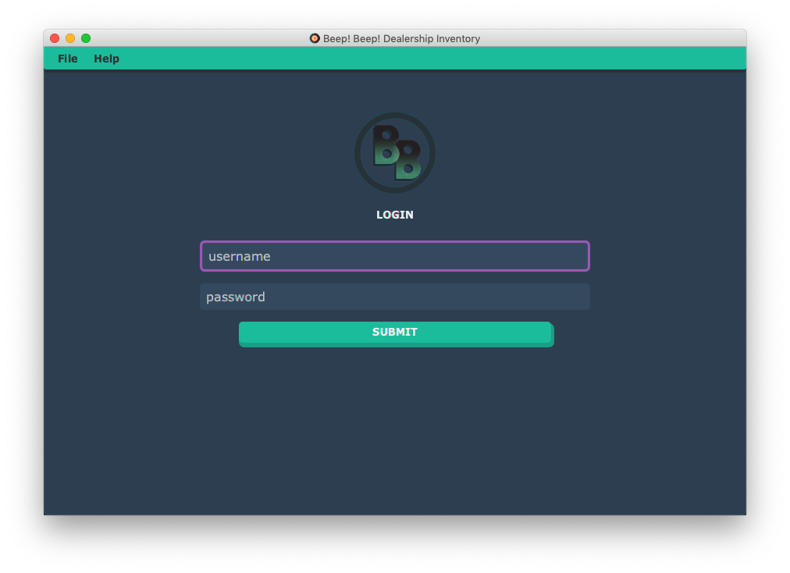
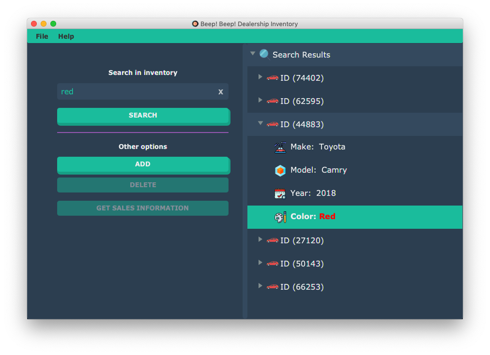
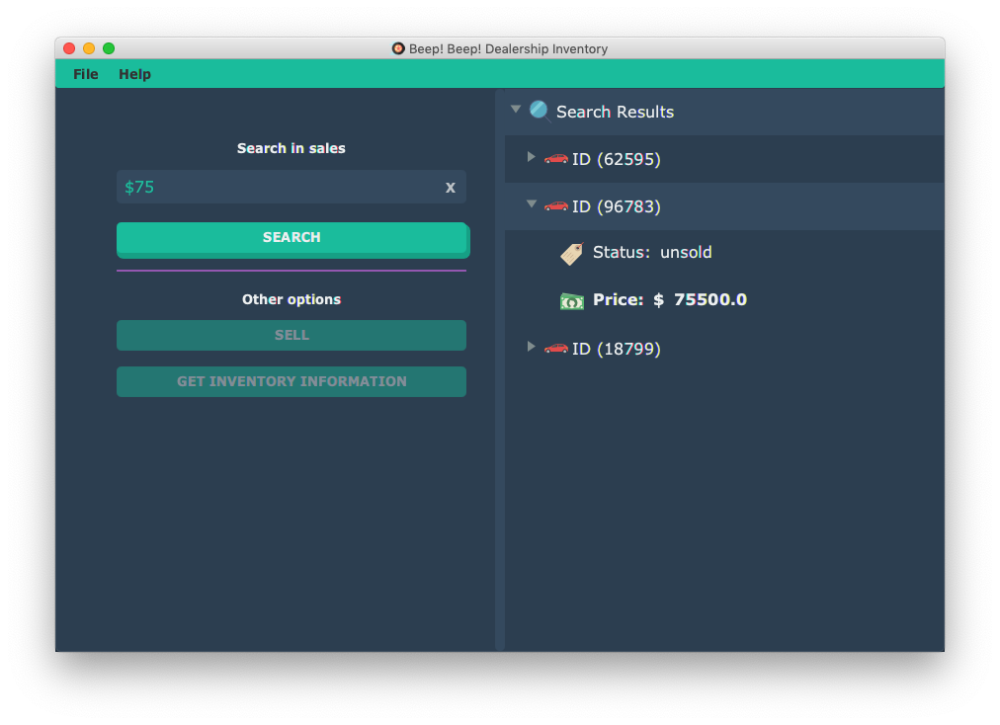

<div align="center">


# Beep Beep Dealership! Application

**A desktop car dealership inventory and sales manager built with JavaFX and a serverless AWS backend.**

Originally built for CIS 2348.


</div>

---

## Features

- **Inventory management**: browse every car on the lot, add new vehicles, and remove old ones.
- **Sales tracking**: view sold vehicles and mark a car as sold to a customer at a final price.
- **Search**: filter by ID, make, model, color, year, price, or sold status.
- **Activity log**: events are written to a local log file you can open from the **Help** menu.

## Screenshots

| Login | Search | Price details |
| :---: | :---: | :---: |
|  |  |  |

## Tech stack

| Layer | Technology |
| --- | --- |
| UI | JavaFX 21 (FXML + CSS) |
| Language | Java 17 |
| Build | Maven, `javafx-maven-plugin` |
| API | AWS API Gateway → AWS Lambda |
| Database | AWS DynamoDB |
| Libraries | Gson, org.json, Lombok |

## Getting started

### Prerequisites

- **JDK 17 or newer** (check with `java -version`)
- **Maven 3.8+** (check with `mvn -v`)

On macOS with Homebrew:

```bash
brew install openjdk maven
```

JavaFX itself does not need to be installed. Maven downloads it automatically.

### Run the app

```bash
git clone https://github.com/Eze-IO/Beep.Beep.Dealership.Application.git
cd Beep.Beep.Dealership.Application
mvn javafx:run
```

The login screen opens. Enter a username to continue to the inventory screen.

### Build only

```bash
mvn clean compile
```

Compiled classes, FXML, and assets end up in `target/classes`.

## Configuration

App settings live in [`resources/configurations.properties`](resources/configurations.properties):

| Key | Purpose |
| --- | --- |
| `title` | Window title |
| `creators` | Credits shown in the app |
| `getListUrl` | Endpoint that lists all cars |
| `getItemUrl` | Endpoint that fetches one car by ID |
| `putItemUrl` | Endpoint that creates or updates a car |
| `deleteItemUrl` | Endpoint that deletes a car by ID |

To point the app at your own backend, deploy Lambda functions behind API Gateway for these four operations and replace the URLs.

> [!NOTE]
> Inventory and sales data come from those AWS endpoints, so they must be reachable for the lists to load or for changes to save. If something goes wrong, check the event log.

## Event log

Errors and activity are written to:

| OS | Location |
| --- | --- |
| macOS / Linux | `~/.Beep.Beep.Dealership.Application/events.log` |
| Windows | `%USERPROFILE%\Beep.Beep.Dealership.Application\events.log` |

You can also open it from **Help → Open event logs** in the app.

## Project structure

```
.
├── pom.xml                         # Maven build (Java 17, JavaFX 21)
├── resources/                      # Config, images, dialog CSS
│   ├── configurations.properties
│   ├── css/
│   └── images/
└── src/Beep/Beep/Dealership/Application/
    ├── Main.java                   # JavaFX entry point
    ├── Core/                       # API client, config, logging, entities
    │   └── Entities/               # Car, Vehicle, API
    └── UI/                         # FXML screens, controllers, Design/*.css
```

## Authors

- **Eze Ahuna**
- **Muhammed Yusuf Yilmaz**
